# UML and workflow handbook

The diagrams describe the implemented DevSphere application. Each diagram has editable PlantUML source, PNG and SVG versions. The object and timing diagrams are explanatory examples, not fabricated runtime evidence.

## Use case diagram

Shows developer actions and the boundaries of the AI provider and isolated runner.

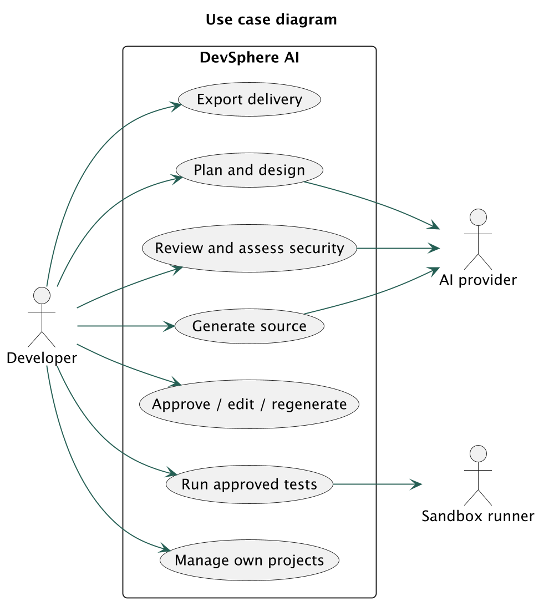

[Editable source](diagrams/01-use-case.puml) · [Vector image](diagrams/01-use-case.svg)

## Class diagram

Core persisted entities and service responsibilities. The complete column dictionary is in the database schema.

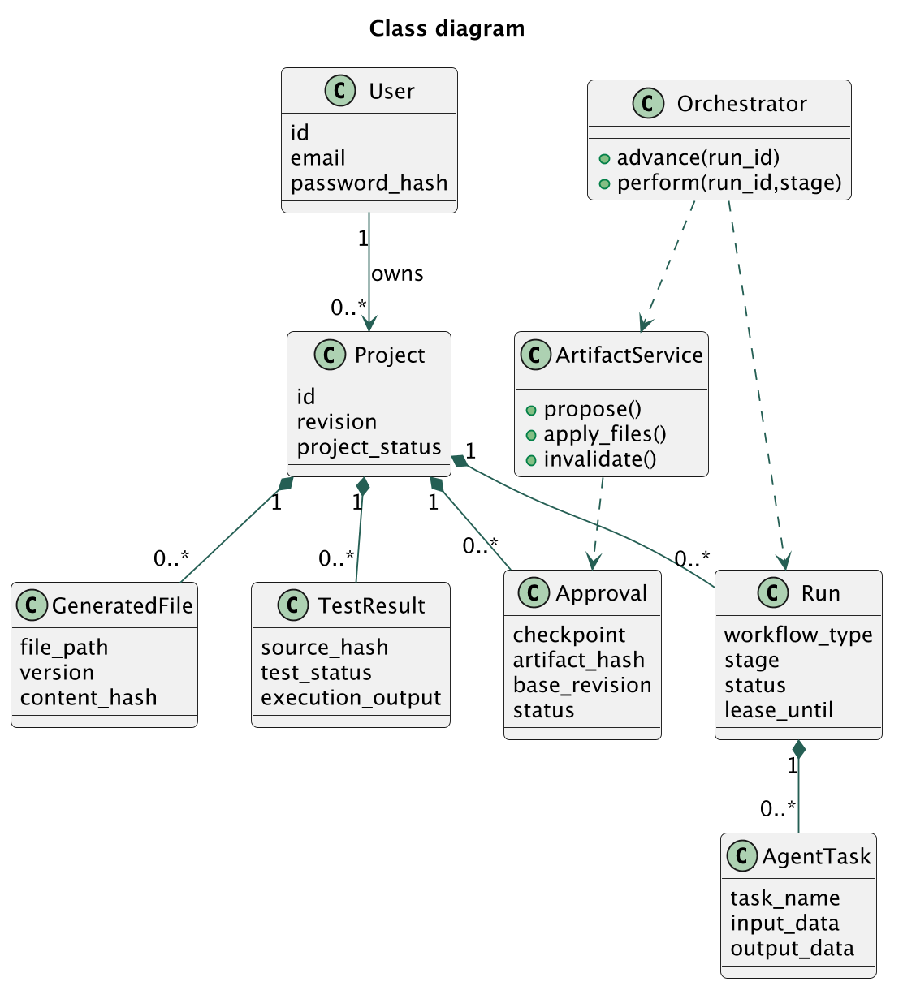

[Editable source](diagrams/02-class.puml) · [Vector image](diagrams/02-class.svg)

## Object diagram

Illustrative snapshot of a workflow paused for architecture review; identifiers here are explanatory examples.

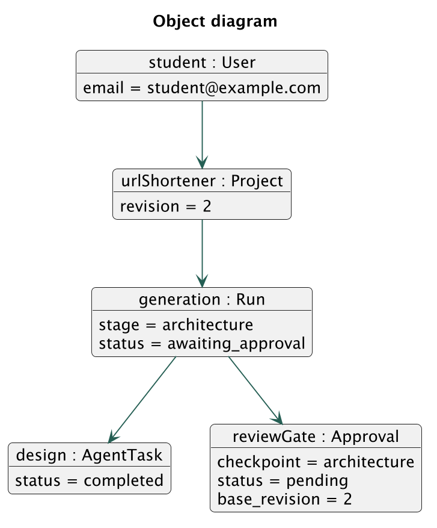

[Editable source](diagrams/03-object.puml) · [Vector image](diagrams/03-object.svg)

## Component diagram

One modular application, one relational database and one separate trusted runner. Agent modules are Python functions.

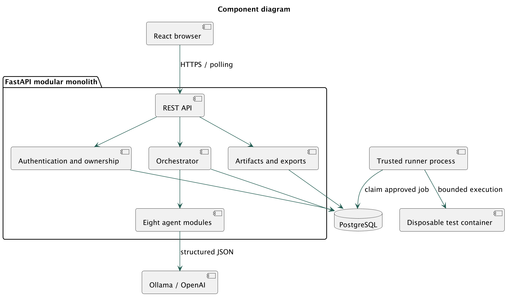

[Editable source](diagrams/04-component.puml) · [Vector image](diagrams/04-component.svg)

## Composite structure diagram

Internal collaboration of the orchestrator component; ports are logical interfaces rather than separate network services.

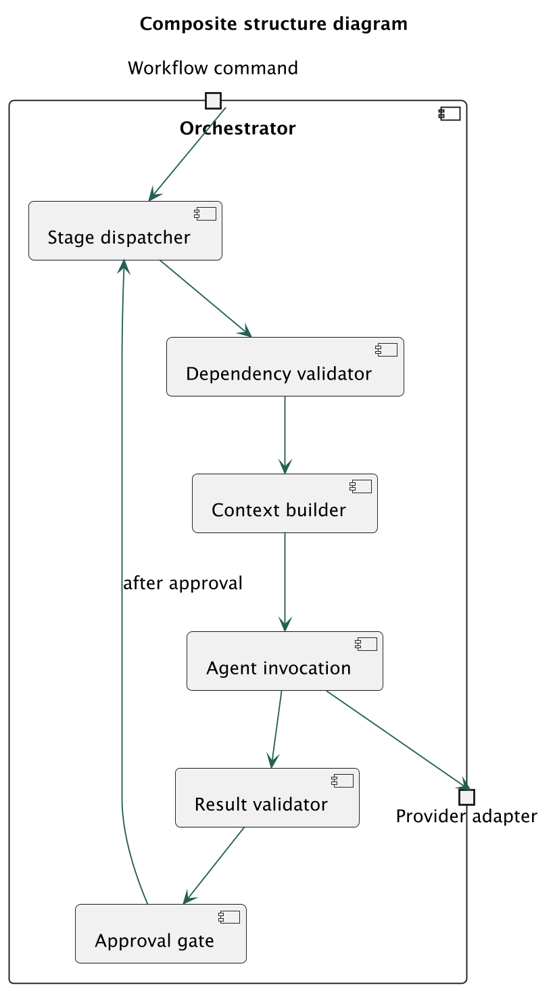

[Editable source](diagrams/05-composite-structure.puml) · [Vector image](diagrams/05-composite-structure.svg)

## Deployment diagram

Local execution has a VM boundary for generated code. A free temporary tunnel exposes only the authenticated application.

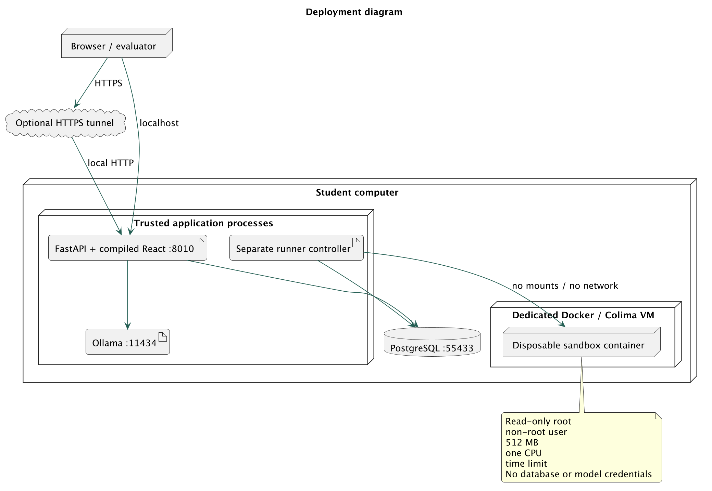

[Editable source](diagrams/06-deployment.puml) · [Vector image](diagrams/06-deployment.svg)

## Package diagram

Source dependencies follow the modular monolith layout. The API never imports the sandbox executor.

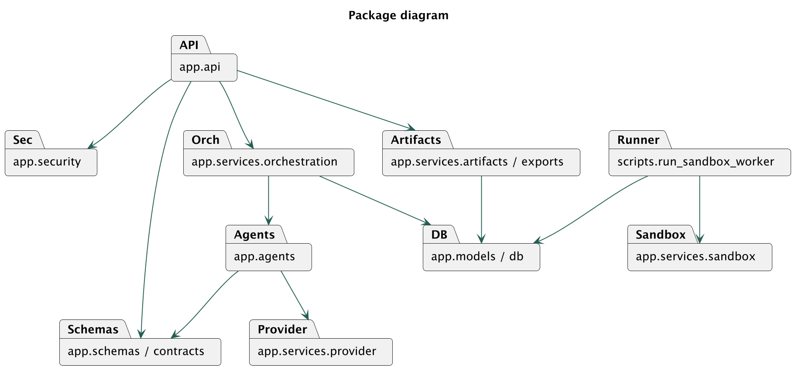

[Editable source](diagrams/07-package.puml) · [Vector image](diagrams/07-package.svg)

## Profile diagram

Design vocabulary used in this project. Stereotypes describe responsibilities; enforcement is implemented in validation, transactions and runner constraints.

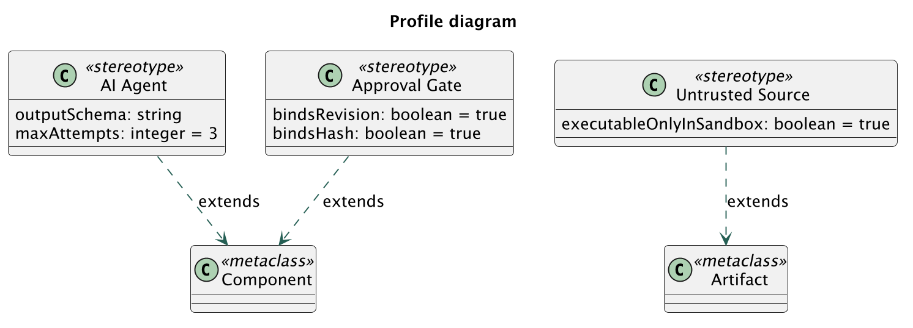

[Editable source](diagrams/08-profile.puml) · [Vector image](diagrams/08-profile.svg)

## Activity diagram

Full workflow includes explicit human gates and a conditional repair loop. Review-only workflows omit generation stages.

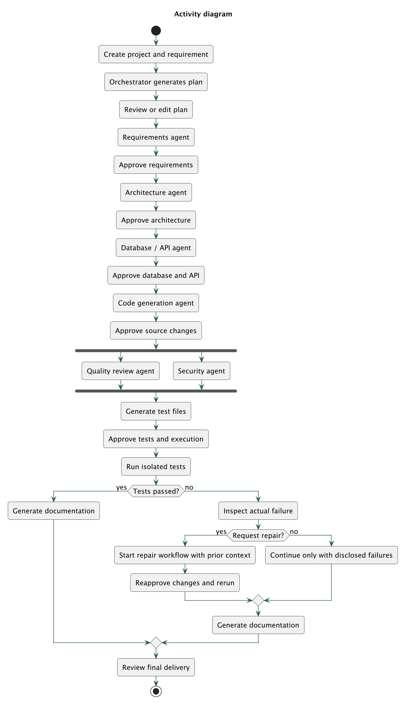

[Editable source](diagrams/09-activity.puml) · [Vector image](diagrams/09-activity.svg)

## State machine diagram

Persisted workflow status transitions, including a lease-expiry recovery path and cancellation.

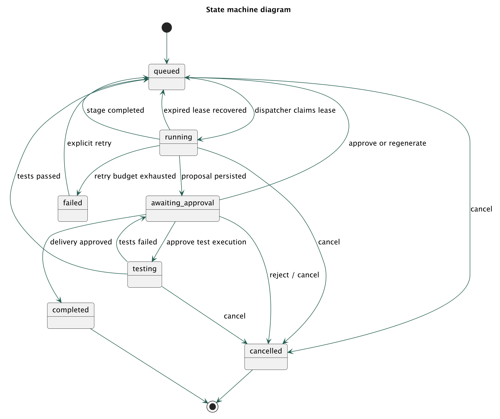

[Editable source](diagrams/10-state-machine.puml) · [Vector image](diagrams/10-state-machine.svg)

## Sequence diagram

Optimistic approval binds both artifact content and project revision, preventing a stale browser action from committing different work.

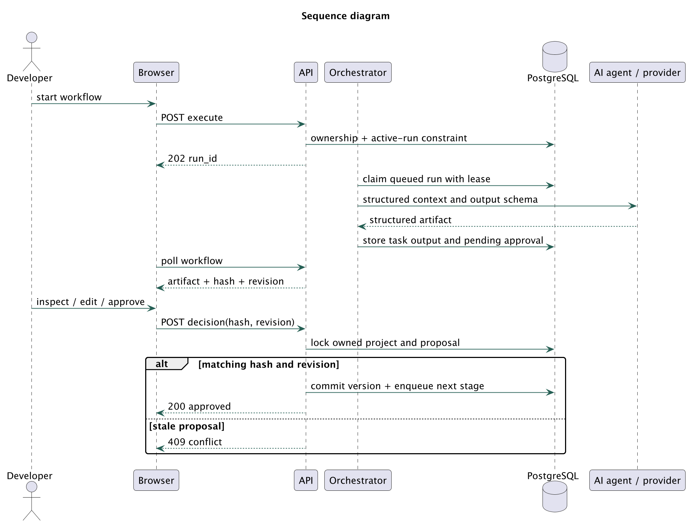

[Editable source](diagrams/11-sequence.puml) · [Vector image](diagrams/11-sequence.svg)

## Communication diagram

Numbered messages express collaboration around an approved test run. This uses object notation for UML communication links.

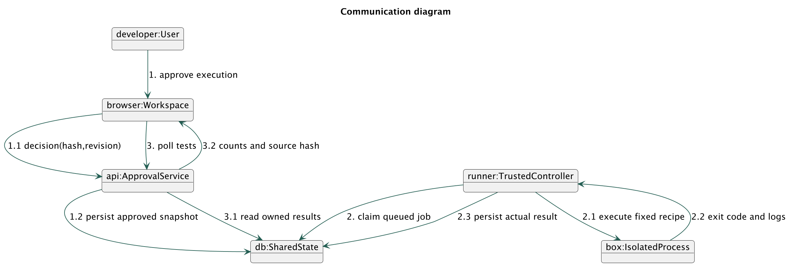

[Editable source](diagrams/12-communication.puml) · [Vector image](diagrams/12-communication.svg)

## Interaction overview diagram

High-level references to detailed interactions. Decisions route complete generation, review-only or repair without running every agent.

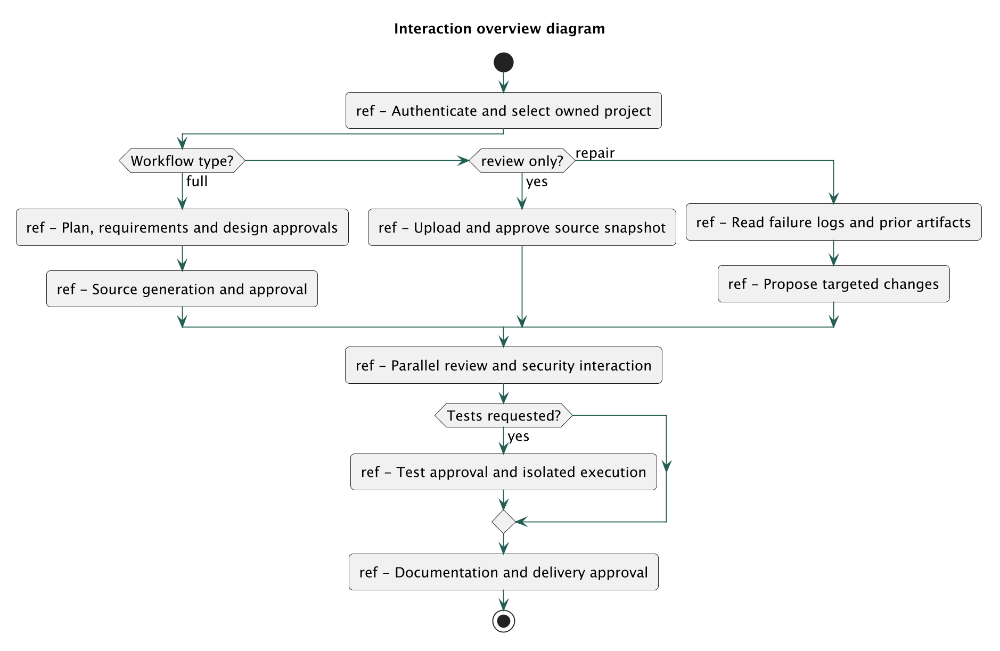

[Editable source](diagrams/13-interaction-overview.puml) · [Vector image](diagrams/13-interaction-overview.svg)

## Timing diagram

Illustrative ordering only; the horizontal units are logical ticks, not measured latency or a performance benchmark.

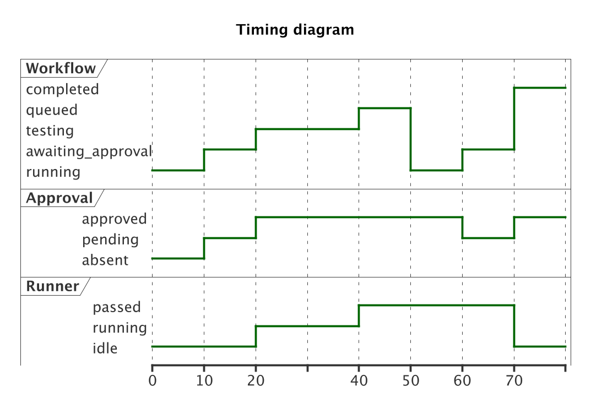

[Editable source](diagrams/14-timing.puml) · [Vector image](diagrams/14-timing.svg)

## Database ER diagram

All thirteen PostgreSQL tables are included. Project ownership is resolved through users and projects for every API operation.

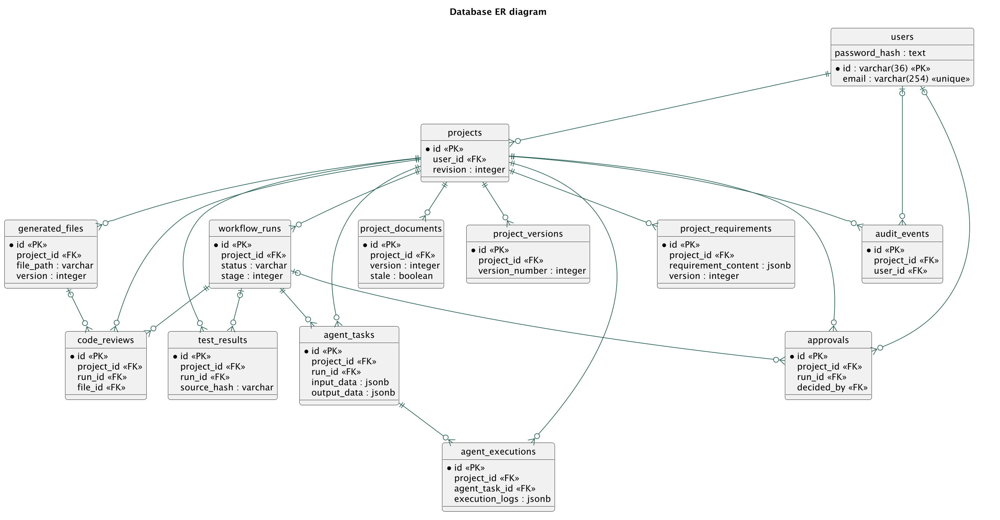

[Editable source](diagrams/15-database-er.puml) · [Vector image](diagrams/15-database-er.svg)

## Rebuild

Install Java and PlantUML, then run `python scripts/create_uml.py`, `plantuml -tpng docs/diagrams/*.puml` and `plantuml -tsvg docs/diagrams/*.puml`. Runtime project diagrams use Mermaid in the browser; PlantUML is only a documentation build tool.

Reference: [PlantUML documentation](https://plantuml.com/).
