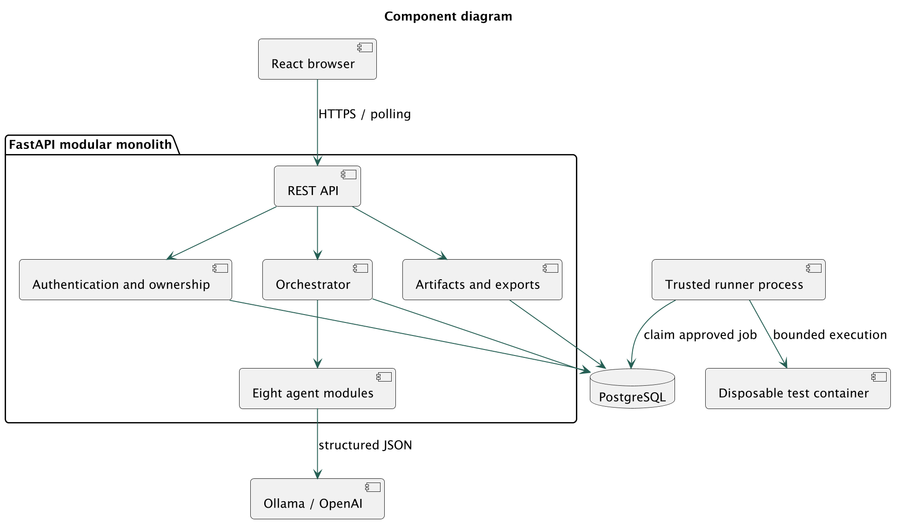
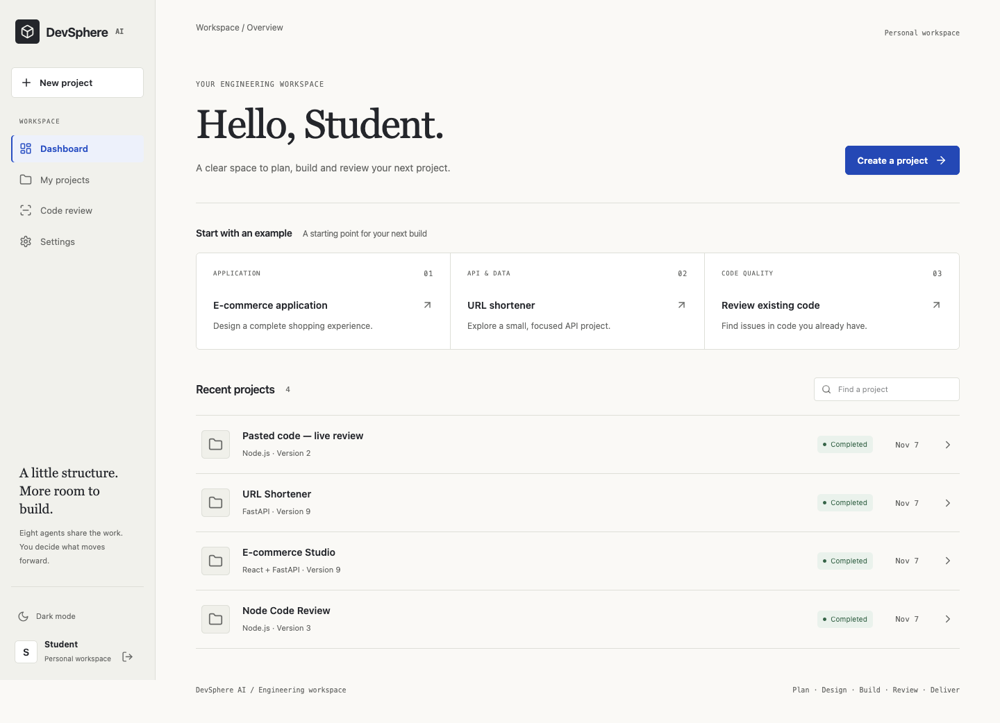
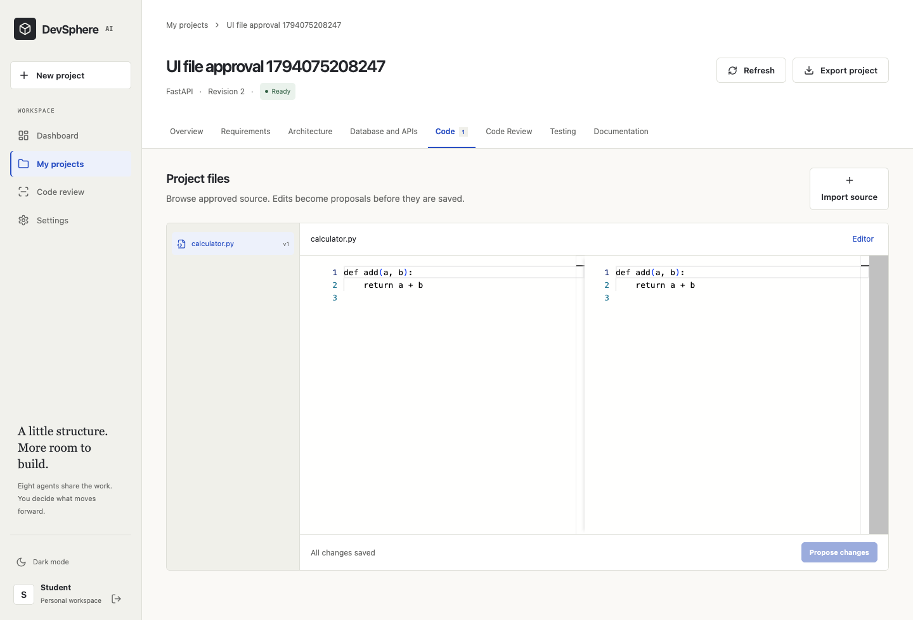

# 1. Abstract

DevSphere AI is an intelligent software engineering workspace that coordinates eight specialized AI agents across requirements, design, implementation, review, testing and documentation. A developer supplies a natural-language brief, then reviews structured artifacts at explicit checkpoints. The system preserves project context, generated file versions, model attempts, human decisions and actual test outcomes in PostgreSQL.

The implementation uses React with JavaScript, FastAPI and a modular Python orchestrator. Model inference is provided by a real Ollama integration, with an optional OpenAI adapter. Generated programs are never executed inside the application process. An independently operated trusted worker runs approved test snapshots in constrained disposable containers. The project demonstrates collaboration through shared state and dependency-aware execution rather than a single question-answer interaction.

# 2. Introduction

Software development involves different kinds of reasoning: clarifying a requirement, choosing a design, implementing a contract, questioning an implementation and checking behavior. A conversational assistant can produce useful text, but a project workspace also needs ownership, explicit state, repeatable execution and evidence. DevSphere combines those engineering controls with specialized model prompts and a simple student-friendly interface.

The intended audience is a student or developer exploring a bounded application or reviewing a small existing codebase. It is an educational platform with practical safeguards, not a claim that arbitrary generated software is production-ready.

# 3. Problem statement

A development assistant should preserve the relationship between a requirement and the source, review and tests derived from it. Without this relationship, a changed brief may leave an old design looking current; a test result may belong to a different source revision; or an AI-generated claim may be mistaken for an executed check. The project addresses these problems with versioned artifacts, source hashes, explicit approval and actual isolated test execution.

# 4. Existing system

The baseline is a conventional chat-assisted development process: developers copy requirements into a model, manually move generated code into an editor, run separate review and testing tools, and assemble documentation themselves. This baseline is a workflow description, not a comparative benchmark of named commercial products.

# 5. Limitations of the baseline

- Context can be fragmented across conversations, source files and reports.
- It can be unclear whether a proposed edit was approved or already applied.
- Review observations may lack reliable file and revision references.
- Test-looking text may be presented without execution evidence.
- Regeneration may overwrite useful work or leave dependent documents outdated.

# 6. Proposed system

DevSphere persists a project-specific engineering state and exposes it through eight workspace tabs. A trusted orchestrator selects a workflow, invokes specialized agents with structured context, validates returned data, and records a proposal. Users approve, reject, edit or request regeneration. Approved source changes create new versions. Independent review and security tasks examine the same source snapshot. The test worker executes only an approved snapshot, then the documentation agent receives the recorded outcome.

# 7. Project objectives

The implemented objectives are to coordinate specialized responsibilities, retain project history, generate inspectable design and source artifacts, provide meaningful review and security hypotheses, execute bounded approved tests, and export understandable deliverables. A further objective is explainability: the user can see what each agent received, produced and failed to complete.

# 8. Functional requirements

| Area | Required behavior |
| --- | --- |
| Accounts | Register without an invitation, sign in, restore a session and sign out. |
| Projects | Create and list owned projects; edit the brief; confirm deletion. |
| Planning | Generate and edit an engineering plan, requirements and acceptance criteria. |
| Design | Generate architecture, Mermaid diagrams, schema SQL and validated OpenAPI. |
| Code | Propose multiple files, inspect differences, approve edits and retain prior versions. |
| Review | Analyze generated/imported source with severity, file references and fixes. |
| Tests | Generate tests, approve exact execution snapshots, show actual results and request repair. |
| Delivery | Generate documents, download Markdown/PDF and export approved project files. |
| History | Retain tasks, attempts, decisions, document versions and source hashes. |

# 9. Non-functional requirements

Project access must be owner-scoped. Model calls must have timeouts and retry limits. File and context input must be bounded. Changes must be transactional and reject stale approval. The UI must work on desktop and mobile, communicate errors clearly and display unknown metrics honestly. Persistence must survive a browser reload and an application restart. Testing of generated code must use an isolated process boundary with resource limits. Performance targets for a large public service are future evaluation work, not measured claims in this release.

# 10. Software and hardware requirements

The native route uses Python 3.12, Node.js 22.12 or newer, PostgreSQL 17, Ollama and a personal Docker daemon. The browser application uses React, Vite, Axios, React Router, Monaco and Mermaid. The backend uses FastAPI, Pydantic, SQLAlchemy, Alembic, Argon2, JWT and ReportLab. Tests use Pytest, Vitest and Playwright Firefox.

An 8B local model benefits from approximately 12–16 GB available system memory alongside the application, with around 15 GB disk space budgeted for downloads and images. These are planning estimates rather than measured minimum specifications. A separately configured API provider can reduce local model resource needs but may have usage charges.

# 11. High-level architecture

The browser communicates with a single FastAPI application. The application owns authentication, project APIs, orchestration, artifacts and exports. PostgreSQL stores durable state. The model provider is accessed through one adapter. A separate trusted worker reads approved test jobs and controls disposable sandbox containers. The web application has no Docker socket access.

# 12. Low-level design

Routes perform input validation and ownership checks, then call project/artifact/workflow services. Services use short SQLAlchemy transactions; model requests occur outside a held project lock. Pydantic defines structured inputs and outputs. Record response contracts derive from persisted column definitions, excluding password hashes. The provider adapter validates model JSON, and each specialized agent adds domain-specific checks where applicable.

Artifacts use SHA-256 content digests. An approval binds a proposal's digest and the project's revision. Applying a file change creates a new row, so comparison and export can reconstruct the current state without destroying the previous version. Changing upstream artifacts marks downstream documents stale.

# 13. Agent architecture

| Agent | Responsibility and handoff |
| --- | --- |
| Engineering orchestrator | Classify the brief and propose milestones/tasks; trusted routing enforces dependencies. |
| Requirement intelligence | Produce an SRS, stories, acceptance criteria, assumptions and open questions. |
| System architecture | Propose components, trade-offs, low-level responsibilities and diagrams. |
| Database and API design | Propose entities, keys, SQL and typed endpoints; compile and validate OpenAPI. |
| Code generation | Produce source files or targeted changes consistent with approved context. |
| Code review and quality | Inspect maintainability, logic, performance and error handling. |
| Bug detection and security | Identify potential vulnerabilities and clearly labelled static observations. |
| Testing and documentation | Generate tests, interpret recorded outcomes and prepare project documents. |

Each invocation receives project/run/task identifiers, the original brief, its assignment, approved artifacts, source context where relevant, constraints and prior decisions. Results contain a typed artifact, agent/task identifiers, status, usage and warnings. Outputs are persisted independently; collaboration occurs through these records, not hidden text pretending that another agent acted.

# 14. Database ER model

The database contains users, projects, project_requirements, workflow_runs, agent_tasks, agent_executions, generated_files, code_reviews, test_results, project_documents, project_versions, approvals and audit_events. Project-owned records reference the parent project. Files and documents have composite version uniqueness. A partial unique index prevents two active runs for the same project.

The full ER diagram is in the companion UML handbook. `docs/05-database.md` lists every column, type, nullability and reference; Alembic files install the schema. JSONB is used for structured task context and outputs. No vector database or separate message broker is needed for this bounded application.

# 15. UML use case model

The developer manages projects, starts workflows, reviews proposals, imports code, approves tests and exports delivery. External actors are the model provider and isolated runner. The complete use case, class, object, component, composite structure, deployment, package, profile, activity, state machine, sequence, communication, interaction overview and timing diagrams are supplied as editable PlantUML plus PNG and SVG.

Object and timing diagrams illustrate design semantics. Their sample identifiers and logical ticks are not represented as observed production events or measured latency.

# 16. Sequence and workflow

A workflow request first validates ownership and active-run constraints. The dispatcher claims work with a lease, builds shared context and invokes the assigned agent. The artifact is validated and persisted as a pending approval. Browser polling reveals the proposal. An approval request locks the project/proposal and compares revision and hash before committing a new artifact version and allowing the next stage.

The full route is plan → requirements → architecture → database/API → code → parallel quality/security → test generation → approved test execution → documentation → delivery. Review-only omits design and source generation. Failed tests create a checkpoint that can initiate a repair workflow with actual failure logs. A model cannot grant itself approval or invent a new executable tool path.

# 17. API documentation

Interactive Swagger is served at `/docs`, with the machine-readable contract at `/openapi.json`. `docs/06-api-contracts.md` describes authentication, request/response conventions and every route. Resource operations cover authentication, projects, workflows, agents, requirements, proposals, files, comparisons, reviews, tests, documents, versions, events and export.

Cookie-authenticated writes require the CSRF header returned by the session API. API clients may use a bearer token. Errors are structured; stale revisions or unmet prerequisites return 409, invalid artifacts return 422, and unowned resources return 404. Protected responses do not expose password hashes.

# 18. Implementation details

`backend/app/agents` contains eight Python modules with separate responsibilities. `services/orchestration.py` manages state and dependencies. `services/artifacts.py` handles approvals, versions and context invalidation. `services/provider.py` encapsulates real model calls. `api/routes.py` exposes operations, while `contracts.py` defines response records. `services/exports.py` produces Markdown, PDF and ZIP content.

`frontend/src` contains the React JavaScript interface. Monaco workers and application assets are bundled locally. Mermaid uses strict mode and sanitized SVG; unsupported syntax is shown as source with a visible error. Source imports accept validated text files, not arbitrary archives or executables. `sandbox/run.py` is a trusted fixed test harness, separate from generated application files.

The phase-by-phase module map and run commands are in `docs/07-implementation.md`.

# 19. Interface and screenshots

The dashboard uses a small sidebar, readable project rows and three starter ideas. The workspace presents Overview, Requirements, Architecture, Database and APIs, Code, Code Review, Testing and Documentation. A pending approval appears prominently with inspect, edit, regenerate and approve actions. Advanced details are expandable instead of occupying the main view.

Desktop and mobile screenshots are generated from the actual running application by the Firefox end-to-end checks. They are not design mockups. Execution labels in a screenshot describe the state when it was captured.

# 20. Testing methodology

Testing separates platform behavior from model quality. Unit tests use explicitly labelled model fixtures to check agent schemas and orchestration deterministically. API/database tests use a dedicated PostgreSQL test database. Security-related tests verify ownership, CSRF, unsafe paths, credential-like input, stale approvals and export behavior. Sandbox tests run actual Python, Node and Java processes in disposable containers and verify network denial, read-only root, excluded secrets, timeouts and failure accounting.

Frontend component tests exercise safe rendering and honest empty/unknown states. Playwright tests use Firefox for dashboard/workspace navigation, import/approval, editor comparison and responsive navigation. Provider simulation tests exercise success, HTTP failure, malformed JSON and timeout behavior. Live demonstration projects use real local Ollama calls, with edits and failures preserved.

# 21. Test results and demonstration evidence

The platform validation run on 7 November 2026 passed 47 Pytest checks, including actual constrained container tests. Five frontend component tests and four Firefox end-to-end checks passed. Four provider fault simulations produced their expected outcomes. The Docker application and PostgreSQL services reached healthy readiness, and the temporary HTTPS entry point passed authentication and secure-cookie checks.

These counts validate the DevSphere platform and the stated fixtures. Generated application results are reported separately, with source hashes and actual sandbox logs. The release validation record is in `docs/08-testing.md`; machine-readable live evidence and sample exports are under `samples/live`. Automated-test fixtures are not presented as live research or AI outputs. No test coverage percentage, throughput, security certification or benchmark is claimed without a corresponding measurement.

The three demonstration scenarios are a URL-shortening API, an educational e-commerce slice and a review-only Node.js fixture. The e-commerce scenario does not process real payments. The review fixture is intentionally vulnerable sample input and is never deployed. The demonstration record identifies model-generated artifacts, human corrections, actual tests and remaining limitations separately.

# 22. Advantages and limitations

The platform makes approvals, provenance and project context visible. It supports conditional workflows, real model calls, immutable versions and actual bounded testing without introducing unnecessary infrastructure. Its small UI lets students explain the engineering lifecycle clearly.

Limitations include model-dependent correctness, a bounded context/file budget, single-coordinator/single-runner operation, basic owner-only authorization, no self-service password reset, no token revocation list, no comprehensive dependency advisory scanner, and no full repository import/indexing. Generated file deletion/renaming is not a dedicated operation. OpenAPI compilation supports a compact teaching contract; rich nested schemas need review. Docker isolation reduces risk but is not a guarantee against all container or kernel vulnerabilities. Public internet-scale multi-tenancy requires additional hardening and stronger execution isolation.

# 23. Future enhancements

Future work includes role-based collaboration, reviewed repository integrations, richer contract schemas, selected-file context retrieval, formal requirements-to-test traceability, model-quality evaluation datasets, coverage collection, dependency advisory integration, stronger sandbox service boundaries, password reset and revocable sessions. These are extension proposals rather than features silently claimed in the current release.

# 24. Conclusion

DevSphere demonstrates an end-to-end engineering workspace with specialized model responsibilities, structured handoffs, durable state, human review, file history and actual isolated test execution. The central lesson is that useful autonomy depends on explicit boundaries and evidence: models propose work, the orchestrator controls progression, people approve consequential changes, and actual processes supply test outcomes.

# 25. References

- FastAPI documentation: https://fastapi.tiangolo.com/
- SQLAlchemy transaction/versioning documentation: https://docs.sqlalchemy.org/en/20/orm/versioning.html
- PostgreSQL SQL reference: https://www.postgresql.org/docs/current/sql-select.html
- Ollama structured outputs: https://docs.ollama.com/capabilities/structured-outputs
- OpenAI structured outputs: https://developers.openai.com/api/docs/guides/structured-outputs
- Docker execution/resource controls: https://docs.docker.com/engine/containers/resource_constraints/
- Mermaid security/configuration: https://mermaid.js.org/config/usage.html
- PlantUML documentation: https://plantuml.com/
- Vitest documentation: https://vitest.dev/guide/
- Cloudflare Quick Tunnels: https://developers.cloudflare.com/tunnel/get-started/quick-tunnels/
- Hosting plans: https://render.com/docs/free; https://neon.com/pricing

<!-- pagebreak -->

# Appendix A. Run and present the project

1. Extract the source into a new personal folder.
2. Follow `docs/02-local-setup.md` to create a Python environment, initialize PostgreSQL, prepare Ollama and build the sandbox.
3. Run `npm ci --prefix frontend` and `npm run build --prefix frontend`.
4. Run `backend/.venv/bin/python scripts/start_local.py` and open http://localhost:8010.
5. Create an account without an invitation token. Check Settings for the configured model and online runner.
6. Create a project, start a workflow and inspect each approval before continuing.
7. Show the actual review, security and sandbox test results. Explain any remaining failures or hypotheses.
8. Download the final report and export the approved project ZIP.
9. For a remote presentation, use the temporary HTTPS procedure in `docs/09-deployment.md` and keep the computer awake.
10. Stop the public tunnel after the presentation; keep the database and secrets private.

The complete operating walkthrough, including regeneration, code comparison and repair, is in `docs/04-user-guide.md`. The source archive includes all guides, migrations, tests, diagrams and environment examples.
